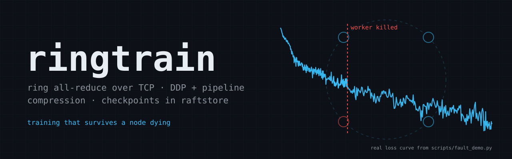
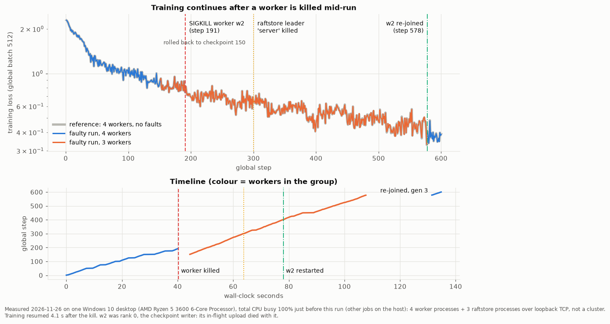
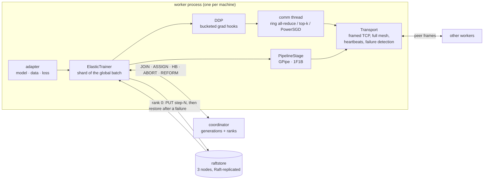
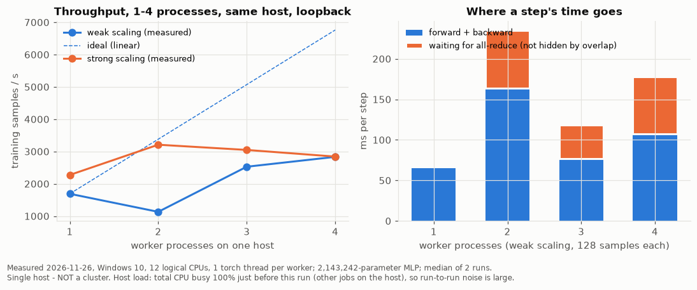
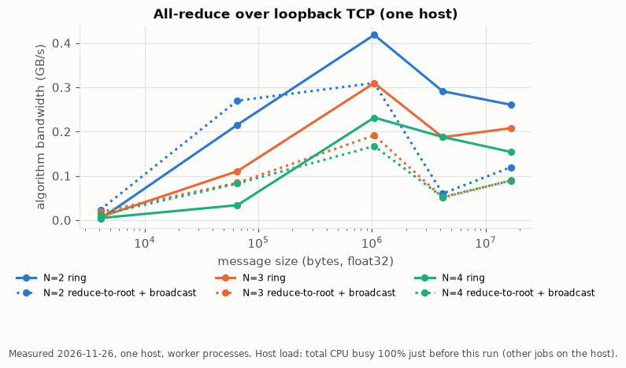
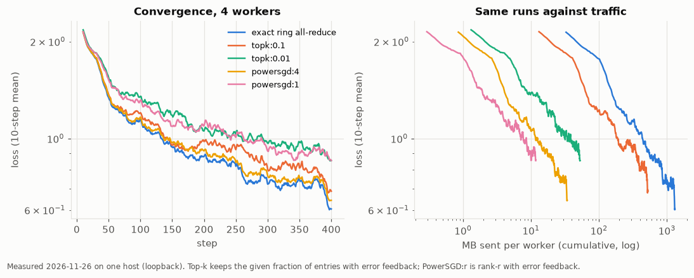
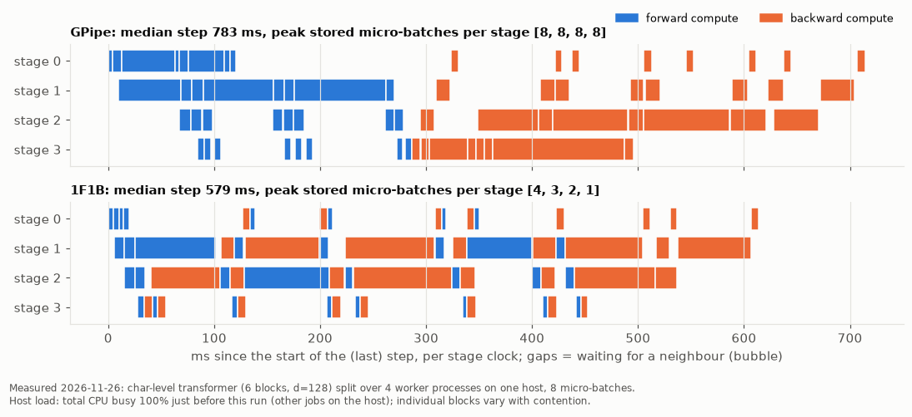
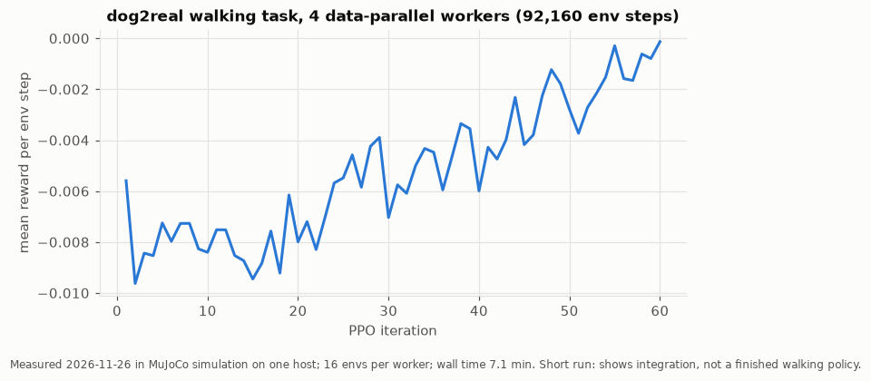

<p align="center">
  
</p>

<p align="center">
  <a href="https://github.com/coopersimpson101-debug/ringtrain/actions/workflows/ci.yml"></a>
  <a href="https://github.com/coopersimpson101-debug/ringtrain/releases/latest"></a>
  <a href="LICENSE"></a>
  
  
  
</p>

**Distributed training for a home cluster, with every byte of communication written by hand.**
ringtrain implements ring all-reduce over framed TCP, DDP-style data parallelism, GPipe/1F1B
pipeline parallelism and gradient compression, and stores checkpoints in a
[raftstore](https://github.com/coopersimpson101-debug/raftstore) cluster so that a run keeps
going when a machine dies. PyTorch is used for tensors and autograd only.

<p align="center">
  <a href="#quickstart">Quickstart</a> ·
  <a href="#how-it-works">How it works</a> ·
  <a href="#results">Results</a> ·
  <a href="#status">Status</a> ·
  <a href="docs/design.md">Design notes</a> ·
  <a href="docs/adapters.md">Adapters (tinylm, dog2real)</a> ·
  <a href="deploy/README.md">Cluster deployment</a>
</p>

<p align="center">
  
  <br>
  <sub><b>A real run, not a simulation</b> (<code>python scripts/fault_demo.py</code>, logs in
  <a href="results/fault_demo/">results/fault_demo/</a>): 4 worker processes train, worker <code>w2</code>
  (rank 0, the checkpoint writer) is killed with <code>TerminateProcess</code> at step 191, the survivors
  re-form as 3 and roll back to the last checkpoint in raftstore, the raftstore <i>leader</i> is killed at
  step 300, and a restarted <code>w2</code> re-joins. Grey: the same run without faults. One Windows desktop,
  loopback TCP, other jobs saturating the CPU; not a cluster.</sub>
</p>

## Highlights

- **No communication library.** Framed TCP transport, rendezvous, heartbeats, ring all-reduce,
  pipelined broadcast, dissemination barrier and all-gather are all in `ringtrain/` (≈3 k lines with docstrings);
  `torch.distributed` is never imported.
- **Collectives are exact.** Ring all-reduce equals the naive sum bit-for-bit on integer-valued
  float32/int64 data for 1-5 ranks and sizes 0 to 65,537, and all ranks end bitwise identical.
- **Parallelism checked against one process.** DDP with gradient bucketing and comm/compute overlap
  matches single-process SGD for 1-4 ranks (1e-5); a 4-stage 1F1B pipeline of a transformer is
  **bit-for-bit** identical to sequential training, and in a 4-process run both GPipe and 1F1B
  reproduced the single-process losses exactly for 12 steps.
- **Survives a node dying.** Killing a worker mid-run (above) showed up in the survivors as a connection
  reset within a fraction of a second, training resumed 4.1 s later on 3 workers from the raftstore checkpoint, and the loss tracked
  the uninterrupted run (mean relative difference 0.3 %); a restarted worker re-joined at a step
  boundary without a rollback. The end-to-end test asserts every step's loss against single-process
  training (2e-4).
- **Gradient compression with error feedback:** top-k (Stich et al. 2018) and PowerSGD (Vogels et al.
  2019), with a measured convergence-vs-traffic comparison.
- **Trains dog2real policies:** dog2real's own PPO, networks and MuJoCo quadruped environment run
  data-parallel (DD-PPO) with synchronised normalisers and adaptive learning rate.
- **Hand-off to tinylm** through a five-method adapter interface ([docs/adapters.md](docs/adapters.md)).

## Status

| | |
|---|---|
| ✅ **Done & tested here** | Transport, rendezvous, failure detection, all collectives, DDP, GPipe/1F1B, top-k, PowerSGD, checkpoints in a real 3-process raftstore cluster (incl. killing its leader), elastic shrink/re-join with real `TerminateProcess` kills, DD-PPO with dog2real. Test suite passes on Windows 10 / Python 3.12; CI is set up to run it on Ubuntu (3.10-3.12) and macOS (not yet run: the repository has not been pushed). |
| 🧪 **Single host only** | Every performance number below: 1-4 worker *processes* on one 6-core desktop over loopback TCP, with other heavy jobs running on it. They show protocol and Python overheads, not network scaling. |
| ⏳ **Needs the cluster** | Multi-machine scaling over the LAN (NAS, Pi 5, server, M1), pulling the power on a worker (heartbeat-timeout path), tinylm through the adapter, long dog2real runs. Configs and commands in [deploy/](deploy/README.md); empty tables [below](#hardware-validation--todo-for-the-author). |

## Quickstart

```sh
git clone https://github.com/coopersimpson101-debug/ringtrain && cd ringtrain
pip install torch --index-url https://download.pytorch.org/whl/cpu && pip install -e ".[test,plots,raftstore]"
python -m pytest -q -m "not slow and not cluster"      # collectives, DDP, pipeline, compression over loopback
python scripts/fault_demo.py                           # 4 workers + 3 raftstore nodes; kill one, watch it recover
python scripts/make_figures.py                         # redraw every figure from results/
```

<details>
<summary><b>Run it by hand: a coordinator and some workers</b></summary>

```sh
python -m ringtrain coordinator --port 29400 --min-workers 1 --max-workers 4
# in 2-4 other terminals (or machines: add --host 0.0.0.0 --advertise <this machine's IP>)
python -m ringtrain worker --coordinator 127.0.0.1:29400 --store dir:/tmp/ckpt --run demo \
    --adapter mlp --steps 1000 --log /tmp/w$RANDOM.jsonl
# kill any worker, start another one: the group shrinks, rolls back to the checkpoint, grows again
python scripts/summarise_logs.py /tmp/w*.jsonl
```

`--store raftstore:http://10.0.0.10:8080,http://10.0.0.11:8080,http://10.0.0.12:8080` puts the
checkpoints in raftstore, `--compression powersgd:4` or `topk:0.01` compresses gradients, and
`--adapter my.module:factory` trains your own model ([docs/adapters.md](docs/adapters.md)).
</details>

## How it works



**Ring all-reduce.** The buffer is cut into *N* chunks. In *N−1* reduce-scatter steps rank *r* sends
chunk *(r−s) mod N* to *r+1* and adds the chunk arriving from *r−1*; afterwards it owns the complete
sum of chunk *(r+1) mod N*. *N−1* all-gather steps circulate the finished chunks. Each rank sends
`2(N−1)/N · n` elements, the bandwidth lower bound (Patarasuk & Yuan 2009), versus `(N−1)·n` through
the root for reduce-then-broadcast. Chunks are split into 1 MiB segments and sends are asynchronous,
so a rank transmits, receives and adds at the same time. Every operation's messages carry a tag
`[channel | sequence | sub-op]`, so DDP's comm thread and the training thread share sockets safely.

**Data parallelism.** A `post_accumulate_grad` hook marks each parameter ready; full ~1 MiB buckets
(reverse layer order) are reduced on a background thread *while backward is still running*, in bucket
order so all ranks issue the same collectives. Each rank back-propagates `Σ loss_i / B_global` and the
all-reduce sums, so the update does not depend on how many workers share the batch:
`∇(1/B) Σ_{i∈B} ℓ_i = Σ_r ∇(1/B) Σ_{i∈S_r} ℓ_i`. The batch at step *t* is a function of `(seed, t)`
only, so the data cursor is just the step.

**Pipeline parallelism.** GPipe runs all *M* micro-batch forwards then all backwards (bubble
`(S−1)/(M+S−1)`, *M* activations stored per stage); 1F1B warms up with `S−s−1` forwards then
alternates, with the same bubble but at most `S−s` micro-batches alive on stage *s* (Narayanan et al.).

**Compression.** Top-k sends the `k` largest entries of `g + e` and keeps the rest in the residual
`e`; PowerSGD runs one warm-started power iteration per weight matrix, `P = ΣM_rQ`, orthonormalise,
`Q' = ΣM_rᵀP̂`, so only `(n+m)·q` numbers cross the wire instead of `n·m`; both use error feedback.

**Fault tolerance.** A peer is declared dead on socket reset/EOF (a killed process) or when nothing
has arrived for `hb_timeout` (a power cut: no RST is ever sent). The coordinator aborts the
generation, the survivors form generation *g+1*, rank 0 fetches `LATEST` from raftstore and broadcasts
it, and training continues. Survivors roll back rather than trust memory, because a rank can die in
the middle of the final all-gather, after some ranks applied step *t* and before others did. A new
worker joining is handled without rollback: the coordinator sets a flag in heartbeat replies, ranks
fold it into the per-step metrics all-reduce so they all see it at the same step, rank 0 checkpoints,
and the group re-forms.

<details>
<summary><b>More: checkpoints, failure detection, derivations, references</b></summary>

- The checkpoint holds model and optimiser state, torch/numpy/python RNG state and the data cursor;
  it is serialised on the training thread and uploaded in the background. `LATEST` is written only
  after raftstore acknowledges the blob (committed on a majority, fsynced), so it never points at a
  blob a majority lacks, and the blob's SHA-256 is verified on load (`torch.load(weights_only=True)`).
- Nothing received from the network is unpickled: frames are length-checked, control messages are JSON.
- Full derivations (ring invariant, 1F1B memory bound, PowerSGD linearity, Chan's parallel variance for
  the PPO normalisers) and references: [docs/design.md](docs/design.md).
</details>

## Results

All numbers come from scripts in `scripts/`, write JSON to `results/` and were measured on
2026-11-26 on **one** Windows 10 desktop (AMD Ryzen 5 3600, 6 cores / 12 threads) with **worker
processes talking over loopback TCP**: same host, not a cluster. During every run, other unrelated
heavy jobs kept the CPU near 100 % busy (recorded as `host_load` in each JSON), so absolute speeds are
pessimistic and noisy.

### 1. Fault injection (hero figure above)

`results/fault_demo/demo_output.txt`, per-worker step logs and the coordinator's membership log:

| event | when | what happened |
|---|---|---|
| start | step 1 | generation 1: 4 workers (MLP, 1.21 M parameters, global batch 512, checkpoint every 25 steps) |
| `TerminateProcess(w2)` | step 191 | w2 was rank 0, so its in-flight upload of checkpoint 175 died with it |
| detect | < 1 s | the 3 survivors' sockets were reset: `PeerFailure` (WinError 10054); the coordinator aborted generation 1 |
| resume | +4.1 s | generation 2 = 3 workers, restored **checkpoint 150** from raftstore (2.1 s), replayed 41 steps |
| kill raftstore leader `server` | step 300 | checkpoints 325 … 575 still committed through the 2 remaining raftstore nodes |
| restart w2 | step 400 | the new process needed ~30 s to start on the loaded host, joined, and the group re-formed as 4 at step 577 without a rollback |
| finish | step 600 | final loss 0.387 (reference run without faults: 0.390); mean relative loss difference over all steps 0.29 %, max 2.6 % (float summation order differs between 3 and 4 shards) |

### 2. Scaling, 1-4 processes on one host 🧪

<p align="center"></p>

`python scripts/bench_scaling.py` → [results/scaling.json](results/scaling.json): teacher-student MLP with
2,143,242 parameters (8.6 MB of float32 gradients per step), 1 torch thread per worker, 30 timed steps,
median of 2 launches.

| workers (processes) | weak: samples/s (128 per worker) | strong: samples/s (global batch 512) | bytes sent per rank per step |
|---|---|---|---|
| 1 | 1,690 | 2,274 | 0 |
| 2 | 1,131 | 3,210 | 8.57 MB |
| 3 | 2,528 | 3,048 | 11.43 MB |
| 4 | 2,834 | 2,843 | 12.86 MB |

What this does and does not show:

- **The traffic is the bandwidth-optimal amount.** Measured bytes per rank are exactly
  `2(N−1)/N × 8.57 MB` (plus 24-byte frame headers): 8.57 → 11.43 → 12.86 MB for N = 2, 3, 4.
- **The speed-up is poor, and this host cannot tell how much of that is ringtrain.** Six physical
  cores were shared with other agents' training jobs (CPU ~100 % busy before the runs), so per-step
  compute time itself swings between 67 and 164 ms across runs; the N = 2 weak-scaling point is
  slower than N = 1 for that reason. On top of that, the all-reduce of 8.6 MB costs 26-71 ms per
  step over loopback, partly hidden by overlap.
- With 4 workers, turning overlap **off** gave 3,170 samples/s against 2,834 with it on: on a
  saturated host the extra comm thread competes for the same cores, so overlap does not pay here.
  Top-k 0.01 and PowerSGD rank 4 cut traffic to 0.51 and 0.17 MB/step/rank but were *slower*
  (2,227 and 2,141 samples/s) because on loopback the compression arithmetic costs more than the
  bytes it saves. Both are the expected loopback results; the LAN is where they should flip (⏳).

<details>
<summary><b>All-reduce bandwidth, ring vs reduce-to-root + broadcast</b></summary>

<p align="center"></p>

[results/allreduce.json](results/allreduce.json). For 4 MiB the ring takes 14.4 / 22.4 / 22.3 ms with
N = 2 / 3 / 4 versus 69.9 / 82.2 / 80.4 ms for reduce-to-root + broadcast (3.6-4.9×); for small
messages (4 KiB) the naive star wins (0.17-0.34 ms vs 0.58-1.50 ms) because the ring pays
`2(N−1)` message latencies. Peak measured algorithm bandwidth is 0.42 GB/s (N = 2, 1 MiB) — a Python
thread-per-socket transport on a loaded Windows host, far below what loopback can carry.
</details>

### 3. Gradient compression

<p align="center"></p>

`python scripts/compression_compare.py` → [results/compression.json](results/compression.json): 4 worker
processes, MLP with 547,338 parameters, global batch 256, 400 SGD steps, identical initialisation and
batches; only the reducer changes.

| reducer | traffic per rank per step | vs exact | loss (last 20 steps) | accuracy |
|---|---|---|---|---|
| exact ring all-reduce | 3.285 MB | 1× | 0.639 | 0.774 |
| top-k 10 % + error feedback | 1.314 MB | 2.5× less | 0.711 | 0.747 |
| top-k 1 % + error feedback | 0.132 MB | 25× less | 0.874 | 0.660 |
| **PowerSGD rank 4** | **0.085 MB** | **38× less** | **0.673** | **0.756** |
| PowerSGD rank 1 | 0.029 MB | 112× less | 0.869 | 0.681 |

PowerSGD rank 4 ends within 6 % of the exact loss while sending 2.6 % of the bytes; top-k at 10 %
sends 15× more than that and still ends higher. Accuracy is on the first 4,096 training samples (this is a
synthetic task; there is no held-out set to overfit against).

### 4. Pipeline schedules

<p align="center"></p>

`python scripts/pipeline_timeline.py` → [results/pipeline.json](results/pipeline.json): byte-level
transformer (embedding + 6 blocks of d = 128 + head, 1.26 M parameters) split by an exact
linear-partition into 4 stages of 0.24 / 0.40 / 0.40 / 0.23 M parameters, one worker process each,
mini-batch of 32 sequences cut into 8 micro-batches, AdamW, 12 steps.

| schedule | median step | peak stored micro-batches per stage | losses vs single-process reference |
|---|---|---|---|
| GPipe | 783 ms | 8, 8, 8, 8 | identical (max \|Δ\| = 0.0 over 12 steps) |
| 1F1B | 580 ms | **4, 3, 2, 1** (= S − s) | identical (max \|Δ\| = 0.0 over 12 steps) |

The bars are compute only, so the gaps are the pipeline bubble. 1F1B holds at most `S − s`
micro-batches' activations instead of all 8, exactly as the schedule promises. That it was also
faster here is not a property of the schedule (both have bubble `(S−1)/(M+S−1)` = 27 %); on this
contended host the two runs saw different CPU availability, so treat the times as indicative only.

### 5. dog2real through ringtrain

<p align="center"></p>

`python scripts/train_dog2real.py --dog2real-root ../dog2real --workers 4 --iterations 60` →
[results/dog2real/train_history.json](results/dog2real/train_history.json): dog2real's `train_walk.yaml`
task (MuJoCo quadruped, domain randomisation on), its default `[256, 128, 64]` actor-critic, 4 worker
processes × 16 environments.

- 60 iterations, 92,160 environment steps in 7.1 min on the loaded host; mean reward per env step rose
  from −0.0056 to −0.0001 and the policy noise σ fell from 1.00 to 0.96. **This is an integration run,
  not a walking policy** — dog2real's own `walk_v0` took 7.7 M steps.
- After the run the four ranks' parameter checksums are identical (`ranks_identical: true`): gradients,
  observation-normaliser statistics and the KL-adaptive learning rate stayed in lock-step.
- The checkpoint is written in dog2real's own format and loads into dog2real's unchanged
  `OnPolicyRunner` (checked; the `.pt` file itself is not committed).
- `tests/test_dog2real.py` additionally checks that the merged normaliser equals a single update on the
  concatenated data, and that 2-rank PPO on dog2real's point-mass task learns with and without PowerSGD.

### Test suite

`python -m pytest` (with `DOG2REAL_ROOT` set) on the same host, 2026-11-26: **137 tests**. The full run
took 16 min on the loaded host; 136 passed and one (2-rank DD-PPO with PowerSGD) hit the 120 s
thread-harness timeout, which was raised to 900 s, after which `tests/test_dog2real.py` passed 4/4.

| file | what it checks |
|---|---|
| `test_collectives.py` | ring all-reduce = naive sum exactly (N = 1-5, float32/int64, sizes 0-65,537); max/min; reduce-scatter ownership; segmenting; pipelined broadcast; barrier ordering; all-gather; two channels in flight; 3 real processes |
| `test_transport.py` | frame validation; rendezvous: rank order kept after a failure, scale-up flag, FINISHED; failure detection by connection drop (< 2 s) and by heartbeat timeout; abort wakes blocked receivers |
| `test_ddp.py` | DDP = single-process SGD for N = 1-4, ranks bitwise identical, buckets launched during backward, overlap on/off identical, unused parameters |
| `test_pipeline.py` | schedules complete and causal; 1F1B in-flight bound; balanced split; GPipe/1F1B = single process (MLP, 2-4 stages); 1F1B bit-exact on a transformer |
| `test_compression.py` | top-k at 100 % exact; error-feedback mass conservation; PowerSGD full rank exact; low rank compresses; all three converge |
| `test_checkpoint.py` | weights-only round trip incl. optimiser and RNG; pruning; async save isolation; corruption detected; **real 3-node raftstore cluster with its leader killed** |
| `test_elastic.py` | 3 worker processes, one `kill()`ed and restarted: shrink to 2, re-join to 3, every step's loss = single-process training (rtol 2e-4); dir store and raftstore |
| `test_dog2real.py` | merged normaliser = single update; DD-PPO ranks identical and learning (with and without PowerSGD); 2 iterations on the MuJoCo quadruped |

## Hardware validation / TODO for the author

Nothing below has been run. Hosts, systemd/launchd units and exact commands are in
[deploy/README.md](deploy/README.md).

**Scaling across machines** ⏳ (MLP adapter, 2.14 M parameters as in the single-host benchmark, 128 samples per worker; gigabit LAN)

| workers | hosts | samples/s | ms/step compute | ms/step waiting on all-reduce | with `powersgd:4` | with `topk:0.01` |
|---|---|---|---|---|---|---|
| 1 | server | | | | | |
| 2 | server, nas | | | | | |
| 3 | + pi5 | | | | | |
| 4 | + m1 | | | | | |

**Fault tolerance on real machines** ⏳

| experiment | detection time | steps rolled back | time to resume | re-join time |
|---|---|---|---|---|
| `kill -9` a worker process | | | | |
| pull the power on the Pi 5 (heartbeat timeout path) | | | | |
| power off a raftstore node during a checkpoint | | | | |
| reboot the coordinator host | | | | |

**Workloads** ⏳: tinylm through the adapter interface (tokens/s for 1-4 machines, loss vs a
single-machine run); a full-length dog2real walking policy trained across the cluster.

## Roadmap

- Uneven sharding for heterogeneous hosts (the Pi 5 currently sets the pace for everyone).
- Combined pipeline + data parallelism (2-D groups); interleaved 1F1B.
- A replicated coordinator (store membership in raftstore) so the coordinator host is not a single point of failure.
- Zero-copy receive straight into the destination buffer; a C extension for the reduction hot loop.
- TLS for the peer protocol and raftstore client; hierarchical (intra-host shared-memory) all-reduce.
- In-memory recovery when all survivors provably completed the same step (skip the rollback).

## License

[MIT](LICENSE) © 2026 the ringtrain authors.
