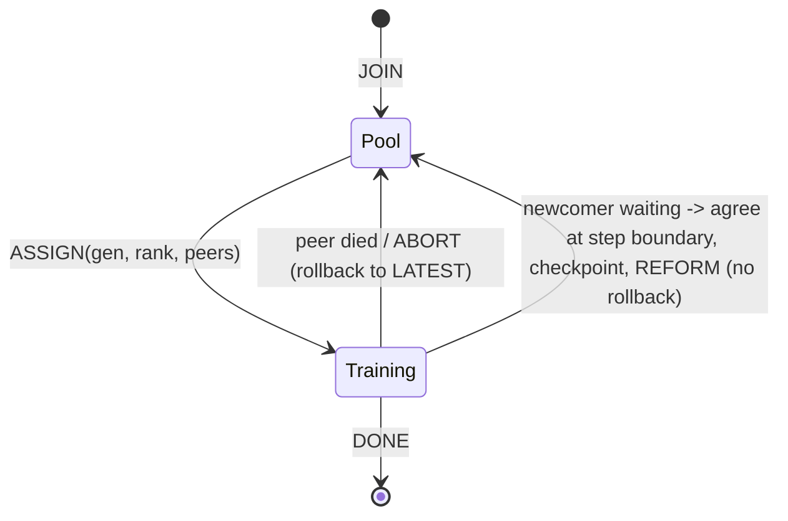

# Design notes and derivations

Everything here is implemented in `ringtrain/` and tested in `tests/`; file names are given per
section.

## 1. Wire format and transport (`wire.py`, `transport.py`)

One frame = 24-byte header `magic "RTF1" | type u8 | pad u8 | src u16 | tag u64 | length u64` +
payload. Types: DATA, HEARTBEAT, CTRL (JSON), HELLO (JSON `{gen, rank}`), BYE.

A generation's ranks form a **full mesh** (rank *i* dials every *j < i*). Each connection has

* a **reader thread** that drains the socket into a mailbox keyed by `(src, tag)`. Because reading
  never waits for the application, two ranks that `sendall` to each other at the same moment cannot
  deadlock on full kernel buffers;
* a **sender thread** fed by a queue, which makes `isend` asynchronous and lets one ring step
  send chunk *k* while receiving chunk *k-1*.

Tags are `[channel:8][sequence:40][sub-op:16]`. Every collective takes the next sequence number of its
channel; since all ranks issue a channel's collectives in the same order, matching needs no
handshake. DDP's background thread uses channel 1 and the training thread channel 0, so a bucket
all-reduce and the per-step metrics all-reduce can be in flight at once
(`test_two_channels_interleave_without_confusion`).

**Failure detection.** A peer is dead when (a) its socket errors or reaches EOF -- what a
`SIGKILL`/`TerminateProcess` looks like, because the OS closes the process's sockets -- or (b)
nothing at all has been received from it for `hb_timeout` seconds; idle links carry a heartbeat
every `hb_interval`. (b) is what catches a power cut or a pulled cable, where no FIN/RST is ever
sent. Any `recv` blocked on a dead peer raises `PeerFailure`; the coordinator's ABORT raises
`GenerationAborted` in ranks that were waiting on a *live* peer that has itself stopped.

## 2. Ring all-reduce (`collectives.py`)

With *N* ranks and a vector of *n* elements split into chunks *C₀..C_{N-1}*:

* **reduce-scatter**, step *s = 0..N-2*: rank *r* sends *C_{(r-s) mod N}* to *r+1* and adds the
  incoming *C_{(r-s-1) mod N}* from *r-1*. By induction, after step *s* the chunk rank *r* just
  received holds the sum over ranks *r-s-1, ..., r* — *s+2* contributions. After *N-1* steps rank
  *r* owns the full sum of *C_{(r+1) mod N}*.
* **all-gather**, *N-1* more steps: rank *r* forwards the completed chunk it received last and
  overwrites the incoming one.

Per rank, traffic is `2 (N-1)/N · n` elements sent and received; the lower bound for any
all-reduce in which every rank ends with the full result is `2 (N-1)/N · n` (Patarasuk & Yuan
2009), so the ring is bandwidth-optimal. Time ≈ `2(N-1) α + 2 (N-1)/N · n β` for latency α and
inverse bandwidth β. Reduce-to-root + broadcast (`naive_allreduce`) moves `(N-1) n` through
the root's link instead.

Chunks are further cut into segments (`segment_bytes`, 1 MiB by default) so the receiver adds
segment *k* while *k+1* is still arriving. **Exactness:** every element's final value is computed
once (by its owner, in a fixed rank order) and then *copied*, so all ranks are bitwise identical;
for integer-valued data the result equals the naive sum exactly (tested for N = 1..5, float32 and
int64, sizes 0, 1, 3, 1000, 65537).

**Broadcast** is a pipelined ring: the root streams segments to *root+1* and each rank forwards
segments as they arrive, so a large blob costs about one transfer plus *N-2* segment times.
**Barrier** is a dissemination barrier (Hensgen, Finkel & Manber 1988): in round *k* rank *r*
signals *r+2^k* and waits for *r-2^k*; after ⌈log₂ N⌉ rounds every rank has transitively heard from
every other.

## 3. Data parallelism (`ddp.py`)

Gradient bucketing with overlap, as in PyTorch DDP (Li et al. 2020) but written from scratch:
parameters are bucketed (≈1 MiB) in reverse registration order; a `post_accumulate_grad` hook marks
each parameter ready; a full bucket is handed to a comm thread **in bucket order** (so every rank
issues identical collectives); `finish()` flushes unused parameters as zeros, waits, writes the
reduced gradient back. `test_overlap_launches_buckets_before_backward_finishes` checks that
buckets really leave during backward.

**Elastic invariance.** With global batch *B* split into shards *S_r*,
`∇ (1/B) Σ_{i∈B} ℓ_i = Σ_r ∇ (1/B) Σ_{i∈S_r} ℓ_i`: each rank back-propagates `loss_sum / B` and the
all-reduce *sums*. The global batch at step *t* depends only on `(seed, t)`, so the update is the
same for any *N*; `test_ddp_matches_single_process[1..4]` and the elastic end-to-end test compare
against a single process (float tolerance 1e-5 relative: only summation order differs).

## 4. Pipeline parallelism (`pipeline.py`)

*S* stages, *M* micro-batches, forward time *f* and backward *b* per micro-batch per stage.

* **GPipe**: all forwards then all backwards. Makespan `(M + S - 1)(f + b)`, ideal `M (f + b)`, so
  bubble fraction `(S-1)/(M+S-1)`. Stage *s* stores activations of all *M* micro-batches.
* **1F1B** (PipeDream-Flush): stage *s* does `S-s-1` warm-up forwards, then alternates F/B, then
  drains. Same makespan and bubble, but at most `S-s` micro-batches are alive on stage *s*:
  activation memory O(S) instead of O(M). `test_1f1b_bounds_in_flight_activations` checks the bound
  on the schedule; `scripts/pipeline_timeline.py` measures it on real processes.

The last stage scales each micro-batch loss by `1/M`, so accumulated gradients equal the full
mini-batch gradient. With 1F1B, micro-batch gradients accumulate in order 0..M-1 like the
sequential reference and activations cross the wire as raw bytes, so the transformer test is
**bit-for-bit** equal; GPipe (same order here) and the MLP tests use tolerance 1e-6.

## 5. Gradient compression (`compression.py`)

**Top-k + error feedback** (Stich, Cordonnier & Jaggi 2018; Lin et al. 2018): `a = g + e`; send the
*k* largest `|a_j|`; `e ← a − top_k(a)`. Ranks all-gather `(index, value)` pairs and scatter-add.
Conservation (tested): `Σ_t sent_t + Σ_r e_r = Σ_t Σ_r g_{r,t}` — nothing is lost, only delayed.

**PowerSGD** (Vogels, Karimireddy & Jaggi 2019): one power-iteration step per matrix with a
warm-started *Q* shared by all ranks: `P = Σ M_r Q` (all-reduce), orthonormalise (Gram-Schmidt),
`Q' = Σ M_rᵀ P̂` (all-reduce), approximation `P̂ Q'ᵀ` = `P̂ P̂ᵀ Σ M_r` — the projection of the
summed gradient on a rank-*q* subspace. Because *Q* and *P̂* are identical on every rank, the
two all-reduces of the *factors* are exactly the all-reduces of the low-rank sum (linearity).
Error feedback `e_r = M_r − P̂Q'ᵀ/N`. With `q = min(n, m)` it is exact (tested).

## 6. Elasticity and checkpoints (`rendezvous.py`, `elastic.py`, `checkpoint.py`)

* The checkpoint holds model and optimiser state, RNG state (torch, numpy, python) and the data
  cursor (the step; samples consumed = step·B). Rank 0 serialises synchronously and uploads in a
  background thread; the `LATEST` pointer is written only after raftstore has acknowledged the
  blob, i.e. after it is committed on a majority and fsynced.
* **On a failure the survivors roll back** to `LATEST` rather than trusting memory: a rank can die
  during the last all-gather, after some ranks have applied step *t* and before others have.
* **Scale-up is graceful**: the coordinator sets `pending` in heartbeat replies; ranks OR it into
  the per-step metrics all-reduce, so all see it at the same step, checkpoint, barrier, re-form.
* Error-feedback residuals are per-rank state; they are reset when the group changes.

## References

- P. Patarasuk, X. Yuan. *Bandwidth optimal all-reduce algorithms for clusters of workstations.* JPDC 2009.
- A. Sergeev, M. Del Balso. *Horovod: fast and easy distributed deep learning in TensorFlow.* 2018.
- S. Li et al. *PyTorch Distributed: Experiences on Accelerating Data Parallel Training.* VLDB 2020.
- Y. Huang et al. *GPipe: Efficient Training of Giant Neural Networks using Pipeline Parallelism.* NeurIPS 2019.
- D. Narayanan et al. *PipeDream: Generalized Pipeline Parallelism for DNN Training.* SOSP 2019; *Memory-Efficient Pipeline-Parallel DNN Training* (PipeDream-2BW / flush), ICML 2021.
- T. Vogels, S. P. Karimireddy, M. Jaggi. *PowerSGD: Practical Low-Rank Gradient Compression for Distributed Optimization.* NeurIPS 2019.
- S. U. Stich, J.-B. Cordonnier, M. Jaggi. *Sparsified SGD with Memory.* NeurIPS 2018.
- Y. Lin et al. *Deep Gradient Compression.* ICLR 2018.
- E. Wijmans et al. *DD-PPO: Learning Near-Perfect PointGoal Navigators from 2.5 Billion Frames.* ICLR 2020.
- D. Hensgen, R. Finkel, U. Manber. *Two algorithms for barrier synchronization.* IJPP 1988.
- T. F. Chan, G. H. Golub, R. J. LeVeque. *Updating formulae and a pairwise algorithm for computing sample variances.* 1979.
